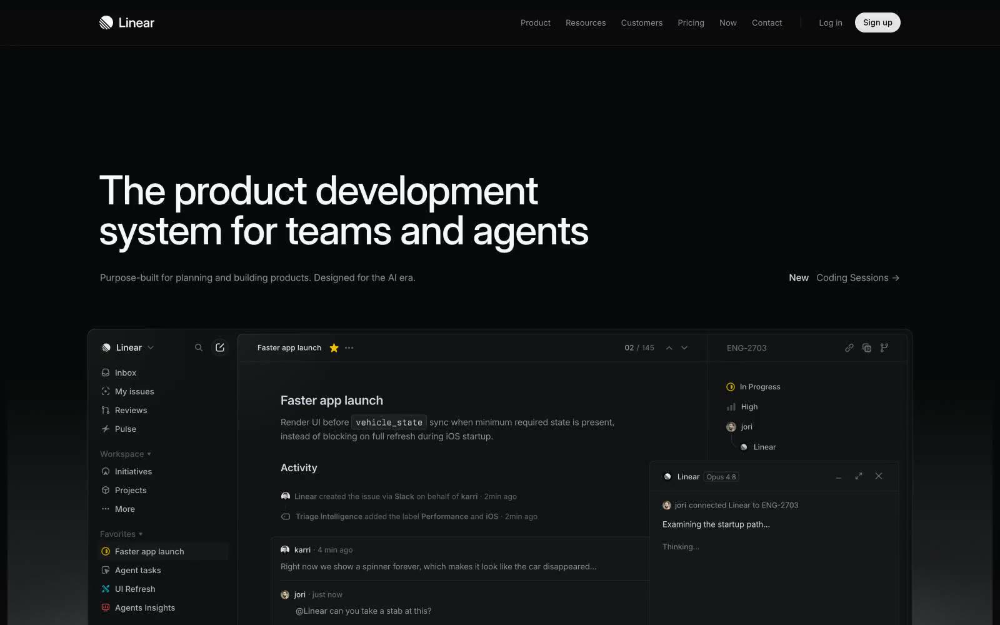

# Linear

[Refero style reference](https://styles.refero.design/style/90ce5883-bb24-4466-93f7-801cd617b0d1) · [Original product](https://linear.app)

Saved and visually inspected on 2026-10-05. Original image capture date unknown.
This is a homepage screenshot with a product illustration, not a live application walkthrough.

## Observed

A dark background, prominent white headline, muted supporting copy, subtle panel boundaries,
and an embedded task view with navigation, activity, and metadata. The illustration separates
primary content from secondary details without many strongly colored surfaces.

## Suggested use

Consider for productivity tools, developer tools, activity views, and restrained marketing
pages. Borrow the visual hierarchy and quiet surface separation. Inspect an actual relevant
product flow before claiming behavior for tabs, resizing, keyboard access, or mobile layouts.

## Adaptation for Rocket

Linear is the user's chosen inspiration for Rocket. Keep Rocket's existing Inter/Geist Mono,
indigo accent, and semantic status colors. Refero's interpreted palette is not authority to
replace them. Do not apply marketing headline sizes or section spacing to compact application
panels. Record project decisions in DESIGN.md rather than changing this shared reference.

## Provenance and editing

The image source and save date are in ../../index.json. Refero labels its style measurements
as normalized and its recommendations as interpreted. Treat its exported tokens as secondary
reference material. This image is research material, not a production asset or a license grant.
Add further screenshots with descriptive names, source URLs, captions, and save dates in the
index. Preserve useful observations when updating this note.
